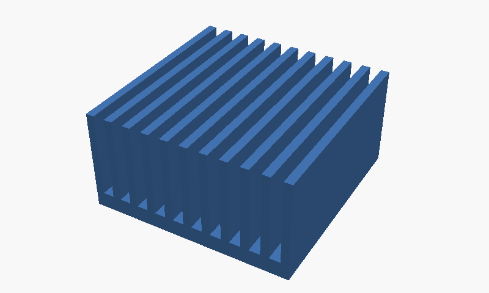

# heat-sink-scad

A parametric straight-fin heat sink in OpenSCAD: a base plate with evenly spaced rectangular fins
standing on it, sized by its outside dimensions and the gap between fins.



## Use it

Open `heat_sink.scad` in [OpenSCAD](https://openscad.org) and set the parameters in the Customizer,
or use the module from another design:

```scad
use <heat-sink-scad/heat_sink.scad>

heat_sink(length = 40, width = 40, height = 20, base_height = 3.2, gap_width = 2.2, num_fins = 11);
```

- `length` runs along the fins (y), `width` across them (x), and `height` is the whole sink, base
  plate included. The sink sits on z = 0 from the origin.
- `base_height` is the base plate's thickness, `gap_width` the gap between neighbouring fins.
- `num_fins` fins share what is left of the width once the gaps are taken out:
  `heat_sink_fin_width(width, gap_width, num_fins)` gives each fin's width, and the console echoes it.
- `examples/chip_sink.scad` builds a 25 mm square sink that way.

It refuses, with a message, a size that can't be made: fins that don't fit the width, a fin count
that isn't a whole number, a base as tall as the sink, or a negative gap.

## Checks

`just test` takes under a second on OpenSCAD 2026.10.15. For four sinks, from the default to a
single fin, it renders each with warnings treated as errors and checks that it's one solid of its
outside size; then it cuts the sink just above the base plate and checks that the fins come out as
`num_fins` separate pieces, each as wide as `heat_sink_fin_width` says, spanning the width. It also
checks the four refusals, and that the example renders as one 25 x 25 x 10 mm solid.

`just check` checks the `.scad` files are formatted with [topiary](https://github.com/tweag/topiary)
0.8.0; `just fmt` formats them. `just images` renders the picture above.

## Plans

Pin fins, mounting holes and presets for common sizes are tracked in the issues.

## Licence

MIT; see [LICENSE](LICENSE).
